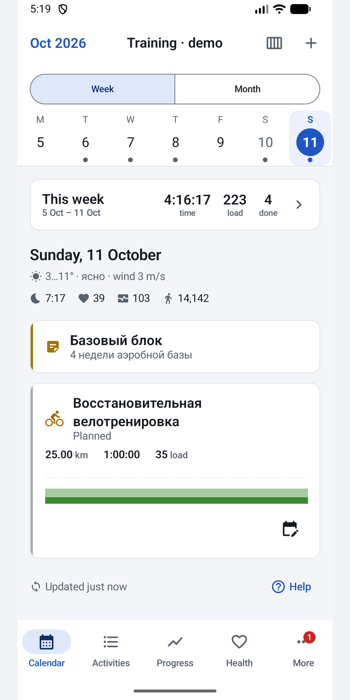
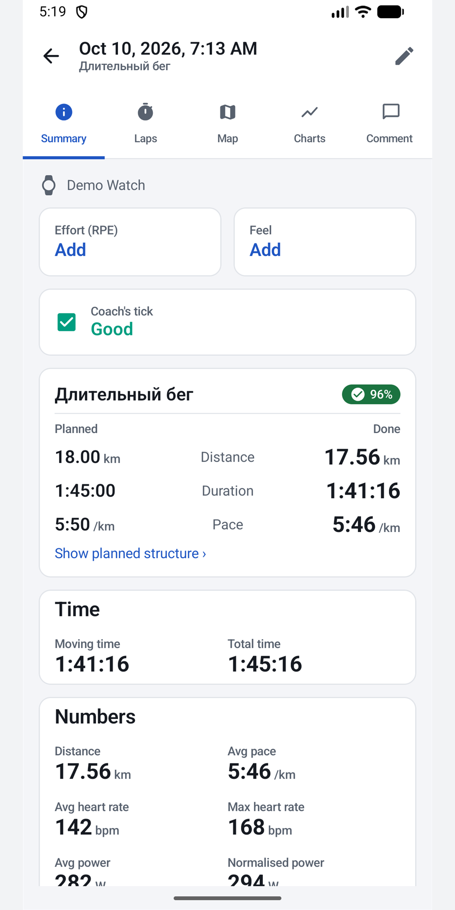
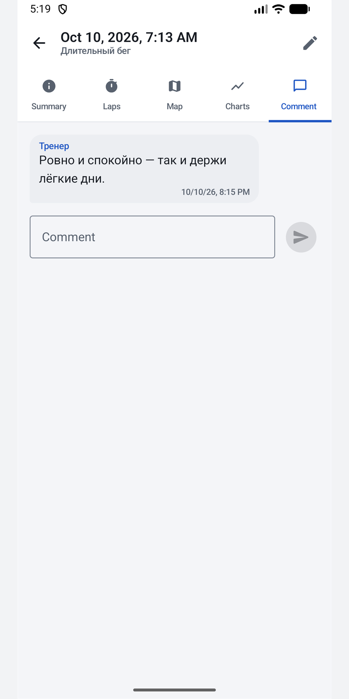
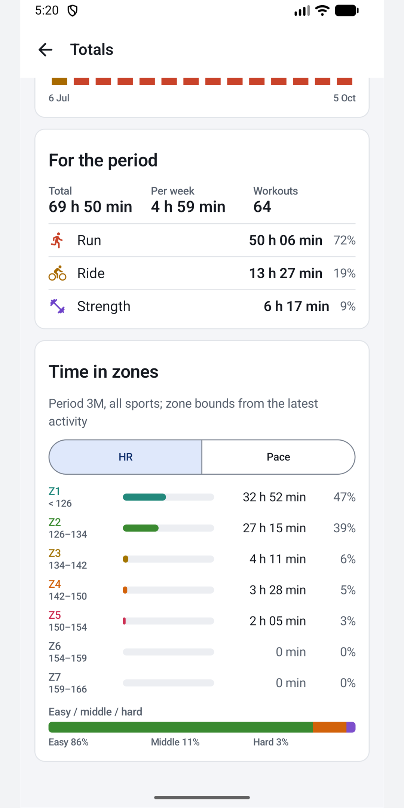

# Weekform for intervals.icu

An Android app for athletes who train with [intervals.icu](https://intervals.icu), and for their coaches. It opens on today, works with no signal, and keeps you in touch with your coach. Free, no ads, no account of ours.

Weekform is independent and is not made by intervals.icu. It uses the public intervals.icu API with your own API key.

**[Download the latest APK](../../releases/latest)** · [Website](https://grravil.github.io/Weekform/) · [Privacy](https://grravil.github.io/Weekform/privacy.html) · [По-русски](#по-русски)

## Install

Weekform is published only here, as an APK.

1. Download `weekform-<version>.apk` from [Releases](../../releases/latest) and open it on your phone (Android 8 or later).
2. Allow installs from your browser or file manager once. Play Protect may warn about an unknown developer; that is normal for apps outside a store.
3. In intervals.icu, open Settings, copy your API key and paste it into Weekform. Or try it first with sample data.

**Updates:** the app checks this page once a day, tells you when a new version is out, and installs it when you tap Update. You can also add this repository to [Obtainium](https://github.com/ImranR98/Obtainium).

## What it does

- **Calendar:** week and month, plan versus done, drag to move, offline edits.
- **Workouts:** structured sessions, your library, mark a gym session done.
- **Analysis:** charts, laps, km splits, map, time in zones for any period, fitness and form.
- **With your coach:** comments with notifications, the coach's mark, RPE, Feel and your note. Coaches get reminders about athletes with nothing planned for tomorrow.
- **Wellness and widgets:** sleep, HRV, resting HR; home-screen widgets.

## Feedback

Found a bug or missing something? [Open an issue](../../issues). The source code is not public; this repository holds the releases, the website and the issue tracker.

## Privacy

Your API key is encrypted on the phone and sent only to intervals.icu. Once a day the app asks this repository's public releases page whether a new version is out (one anonymous request). There is no server of ours, no analytics and no ads. Details: [privacy policy](https://grravil.github.io/Weekform/privacy.html).

---

## По-русски

Android-приложение для тех, кто тренируется с [intervals.icu](https://intervals.icu), и для их тренеров. Открывается на сегодняшнем дне, работает без связи, держит вас на связи с тренером. Бесплатно, без рекламы и без нашего аккаунта. Weekform — независимое приложение, его делает не intervals.icu.

**[Скачать последний APK](../../releases/latest)** · [Сайт](https://grravil.github.io/Weekform/ru/) · [Конфиденциальность](https://grravil.github.io/Weekform/privacy.html#ru)

**Установка**

1. Скачайте `weekform-<версия>.apk` в разделе [Releases](../../releases/latest) и откройте его на телефоне (Android 8 и новее).
2. Один раз разрешите установку из браузера или файлового менеджера. Play Защита может предупредить о неизвестном разработчике — для приложений не из магазина это обычно.
3. В intervals.icu откройте настройки, скопируйте API-ключ и вставьте его в Weekform. Можно сначала попробовать на примере.

**Обновления:** приложение раз в день проверяет эту страницу, сообщает о новой версии и ставит её по кнопке «Обновить». Можно также добавить репозиторий в Obtainium.

**Отзывы и ошибки:** [создайте issue](../../issues) — можно по-русски. Исходный код закрыт; здесь лежат релизы, сайт и обсуждения.
